# Digging GPS Out of the Noise with an RTL-SDR and GNU Radio

*A long, honest walkthrough of my GPS L1 C/A lab: how a cheap dongle, an active antenna, and a pile of GNU Radio blocks can find satellites you cannot see, lock onto them, and read the time they are broadcasting.*

[Code repo here](https://github.com/handiko/GPS-L1-CA-Rx)

---

## Why I did this

Here is the thing that bugged me. Tune an RTL-SDR to 1575.42 MHz, plug in a GPS antenna, open a waterfall, and you see... nothing. Flat noise. No carrier, no hump, no hint that a dozen satellites are shouting at you from 20,000 km away.

And yet my phone gets a fix in seconds. So the signal *is* there. It is just hiding.

I wanted to see it come out of hiding with my own eyes. Not "trust me, the library did it", but actually watch a flat noise floor turn into a sharp line 15–20 dB tall. Then I wanted to keep going: lock onto it, follow it, and finally read the bits it carries until the receiver tells me what time it is.

That is what this lab does. It is called `gps_l1_lab.grc`, and every stage in it is something you can poke with a scope. This write-up is the story of how it works, written for the version of me that was a university student, staring at a correlation equation and wondering why anyone cared.

A warning before we start: I use a lot of DSP words here (correlation, processing gain, NCO, discriminator, loop bandwidth...). I'll explain each one the first time it shows up, but I won't pretend they don't exist. They are the right words, and you'll meet them again.

---

## What I used

- **RTL-SDR dongle** (R820T tuner). Any RTL-SDR works; one with a TCXO and a bias-tee makes life much easier.
- **Active GPS antenna** (the kind with a built-in LNA, powered over the coax at 3–5 V).
- **Windows laptop** with **radioconda** (GNU Radio 3.10). No out-of-tree modules: only stock blocks plus Embedded Python Blocks.
- **Patience**, and ideally a view of the sky. A windowsill sort of works. A rooftop really works.

The files:

- **gps_l1_lab.grc**: the top-level flowgraph
- **gps_acq_branch.grc**: hier block, the acquisition correlator
- **gps_cn0_meter.grc**: hier block, the signal-strength meter
- **gps_track_channel.grc**: hier block, one tracking channel
- **gps_nav_bits.grc**: hier block, bit sync and bit detection
- **gps_l1_lab_README.md**: installation and test notes

There is also a simpler, faster sibling, **gps_l1_despread.grc**, which does acquisition and tracking inside one Python block. The lab is the same receiver with its belly opened up.

---

## The rule I followed

My personal rule for these GNU Radio projects is simple:

> Put each operation in a stock block if one exists. Use an Embedded Python Block (EPB) only for what GNU Radio cannot do natively.

It sounds like a purity thing, but it has a very practical payoff. Every stock block's output is a stream, and every stream can be dropped into a QT GUI sink. So the more of the receiver I build from stock blocks, the more of its insides I can *watch*. That is the whole point of a lab.

Python only gets the jobs stock blocks genuinely can't do:

1. a search that changes what it is looking for on a schedule,
2. a decision made across a two-dimensional grid,
3. a closed loop that has to update every millisecond (tracking),
4. parity checking and frame sync for the navigation message.

Here is the whole lab on one page:

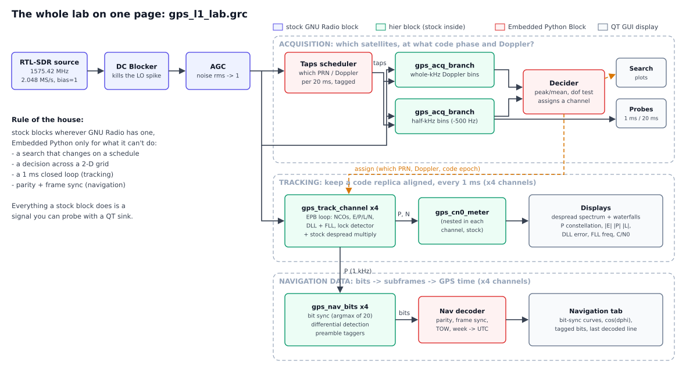

Green boxes are hier blocks (a sub-flowgraph made of stock blocks), red boxes are Python, blue ones are plain stock blocks, grey ones are displays. Keep this picture in mind; the rest of the story walks through it from left to right and top to bottom.

---

## Part 1: what a GPS signal actually is

### Three things multiplied together

Each GPS satellite transmits, on 1575.42 MHz (the L1 frequency), the product of three things:

1. **The navigation message** $d(t)$: slow data at 50 bit/s. Orbit parameters, clock corrections, the time. One bit lasts 20 ms.
2. **The C/A code** $c(t)$: a pattern of 1023 "chips", each +1 or −1, sent at 1.023 million chips per second. So the whole pattern lasts exactly 1 ms and then repeats, forever. Every satellite has its own pattern, called its PRN (pseudo-random noise) number, from 1 to 32.
3. **The carrier** at 1575.42 MHz.

The modulation is BPSK: the data bit flips the sign of the code, and the code flips the sign of the carrier. Written out in complex baseband, after my dongle has mixed 1575.42 MHz down to 0 Hz, one satellite looks like this:

$$r[n] = A\; d[n]\; c(nT_s - \tau)\; e^{j(2\pi f_D n T_s + \varphi)} + w[n]$$

where $\tau$ is how far the code is shifted (the *code phase*), $f_D$ is the frequency offset (satellite Doppler plus my dongle's own tuning error), and $w[n]$ is noise. I sample at 2.048 MS/s, which is a very deliberate choice: one code period is then exactly 2048 samples, about 2 samples per chip. That number will save us a lot of pain later.

Here is what the three layers look like:

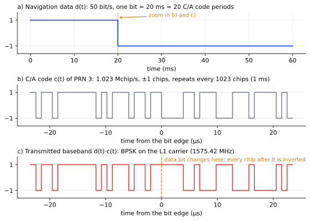

The top plot is one 20 ms data bit. The middle is 48 chips of PRN 3's code. The bottom is what's actually transmitted: the code, with every chip inverted from the moment the data bit flips.

The codes themselves are **Gold codes**: each one is the XOR of two 10-stage linear-feedback shift registers, G1 ($1 + x^3 + x^{10}$) and G2 ($1 + x^2 + x^3 + x^6 + x^8 + x^9 + x^{10}$), with each PRN tapping G2 at a different place. My `ca_code()` function builds them exactly like that. (A nice sanity check from the spec: PRN 1 must start with `1100100000`. Mine does.)

### Why you can't see it

Now the bad news. The spec guarantees only −128.5 dBm at the antenna. My dongle looks at 2.048 MHz of bandwidth, and thermal noise in that bandwidth (with the antenna's LNA setting the noise figure) is around −110 dBm. So the satellite sits about **18 dB below the noise**. Sixty times weaker.

The GPS community prefers to talk in **C/N0** (carrier-to-noise density, in dB-Hz), because it doesn't depend on which bandwidth you happen to look in. A healthy satellite under open sky is around 42–48 dB-Hz. To get the SNR in a bandwidth $B$, you just subtract $10\log_{10} B$:

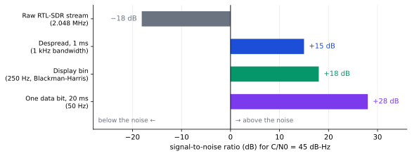

The same 45 dB-Hz satellite is −18 dB in the raw 2 MHz stream, but +15 dB once it's squeezed into 1 kHz. That squeezing is the whole trick.

You might think: fine, just use a narrower display. Zoom the waterfall down to 1 kHz bins. Sadly no. The spreading has smeared the satellite's power over a 2 MHz-wide hump, so any 1 kHz slice holds only a thousandth of it, while holding a full 1 kHz worth of noise. Narrowing the view can't help. The signal has to be *concentrated* first.

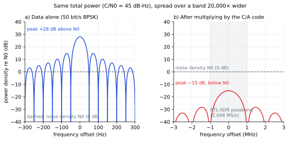

On the left, the 50 bit/s data alone would stand 28 dB above the noise density, in a band about 100 Hz wide. On the right, multiplied by the code, the same power is spread over a band 20,000 times wider, and its peak density sits 15 dB *under* the noise. Same sand, raked flat.

---

## Part 2: despreading, or how the line pops out

### One multiplication

Suppose I somehow know the code phase $\tau$ and the frequency $f_D$ (finding them is Part 3). Then I make my own copy of the satellite's code, line it up, and multiply:

$$y[n] = r[n]\; c(nT_s - \hat\tau)\; e^{-j(2\pi \hat f_D n T_s)}$$

If my copy is lined up, the signal part contains $c \cdot c$. And since every chip is ±1, $(+1)(+1) = +1$ and $(-1)(-1) = +1$. **The code cancels itself.** What's left is the slow 50 bit/s data on an almost constant phasor, squeezed back into about 100 Hz.

The noise also gets multiplied by the ±1 pattern, but it has nothing to cancel against. White noise times a random ±1 sequence is still white noise, with the same power, still spread over 2 MHz.

That asymmetry is the entire magic. **The same multiplication concentrates the signal and leaves the noise alone.** Now a narrow filter (or a narrow FFT bin) keeps all of the signal and only a sliver of the noise.

### Watching it add up

The numerical version of "squeeze into a narrow band" is "add up a lot of samples". Over one code period ($N = 2048$ samples):

- the signal part adds **coherently**: 2048 small pushes in the same direction, growing as $N$;
- the noise adds as a **random walk**: growing only as $\sqrt N$.

So the SNR after summing is $N A^2/\sigma^2 = (C/N_0)\cdot T$. At 45 dB-Hz and $T = 1$ ms, that's $10^{4.5}\times 10^{-3} \approx 32$, or +15 dB. Here is that race, computed sample by sample:

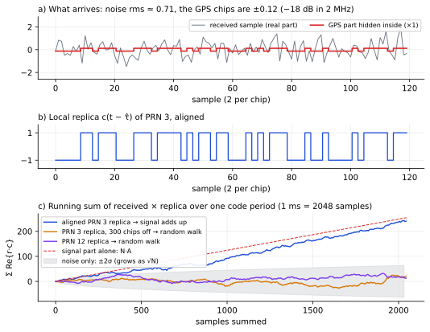

Look at the bottom panel. With the right code correctly lined up (blue), the running sum climbs steadily to about 240. With the right code but 300 chips out of step (orange), or with a different satellite's code (purple), the sum just wanders around inside the grey noise envelope. That climbing blue line is despreading. Everything else in this receiver exists to keep that line climbing.

(You'll see two "processing gain" numbers quoted for GPS, and both are right. **30.1 dB** is $10\log_{10}(1023)$: chips per correlation period, the textbook figure. **33.1 dB** is what *my* receiver gains between its raw 2.048 MHz stream and the 1 ms sum. The extra 3 dB is because the RTL samples more noise bandwidth than the 1.023 Mchip/s signal really needs.)

### The catch: it has to line up

The cancellation only works if my copy of the code is within about half a chip (half a microsecond!) of the incoming one:

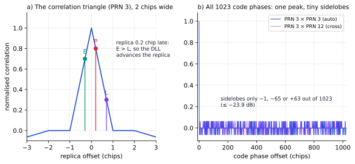

On the left is the famous correlation **triangle**: perfectly aligned gives 100%, half a chip off gives 50% (−6 dB), and one chip or more gives essentially nothing. On the right is every one of the 1023 possible code phases. There is exactly one spike, and the rest is tiny. Gold codes are designed so that a code matched against itself at the wrong shift, or against another satellite's code at any shift, only ever gives −1, −65 or +63 out of 1023. The worst case is −23.9 dB.

That second property is what lets 30-odd satellites share one frequency. It's **CDMA** (code-division multiple access): multiply by PRN 3's code and only PRN 3 despreads, while all the others stay spread and look like a bit more noise. Which also means **tracking several satellites at once costs no extra radio hardware at all**. Each channel is just another replica multiplying the same stream. The limit is CPU.

The frequency has to be right too. If my copy is off by 1 kHz, the phase spins one full turn during each 1 ms sum and cancels itself out:

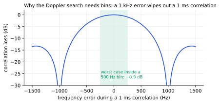

So, before anything despreads, I need **two numbers per satellite: the code phase and the Doppler.** Finding them is acquisition.

---

## Part 3: acquisition, the big search

### What we're searching

For each PRN, I need to try every code phase (2048 of them, at 2 samples per chip) and every Doppler (±10 kHz in 500 Hz steps, so 42 bins). That's about 86,000 combinations per satellite, times 32 satellites. Trying them one at a time would take forever.

### The FFT trick

Correlation in time is multiplication in frequency. So instead of sliding my code across the signal 2048 times, I do:

$$C[\tau] = \text{IFFT}\Big(\text{FFT}\{x\} \cdot \text{FFT}\{c\}^*\Big)$$

One forward FFT, one multiply, one inverse FFT, and I have the correlation at **all 2048 code phases at once**. Because the code repeats every exactly 2048 samples, the circular correlation the FFT computes is exactly the right one. (This is why I insisted on 2.048 MS/s.)

### The Doppler trick I'm quite proud of

The usual way to test 42 Doppler bins is to mix the signal with 42 different oscillator frequencies. That would mean either 42 copies of the chain, or a Python block retuning an oscillator every 20 ms, which is exactly the kind of hidden magic I wanted to avoid.

But look at the numbers: a 2048-point FFT at 2.048 MS/s has bins **exactly 1 kHz apart**. Shifting a signal by $m$ kHz just slides its spectrum by $m$ bins. So instead of shifting the signal, I can slide the *code's* spectrum the other way:

$$\Big|\text{IFFT}\big(\text{FFT}(x\, e^{-j2\pi m n/N}) \cdot C^*\big)\Big| = \Big|\text{IFFT}\big(\text{FFT}(x) \cdot \text{roll}(C^*, m)\big)\Big|$$

Rolling an array is free. The Doppler search becomes "change the taps of a stock Multiply block". For the half-kHz bins I run a second, identical branch with a fixed −500 Hz mixer in front. Two branches × 21 rolls = 42 Doppler bins.

Here is the inside of one branch:

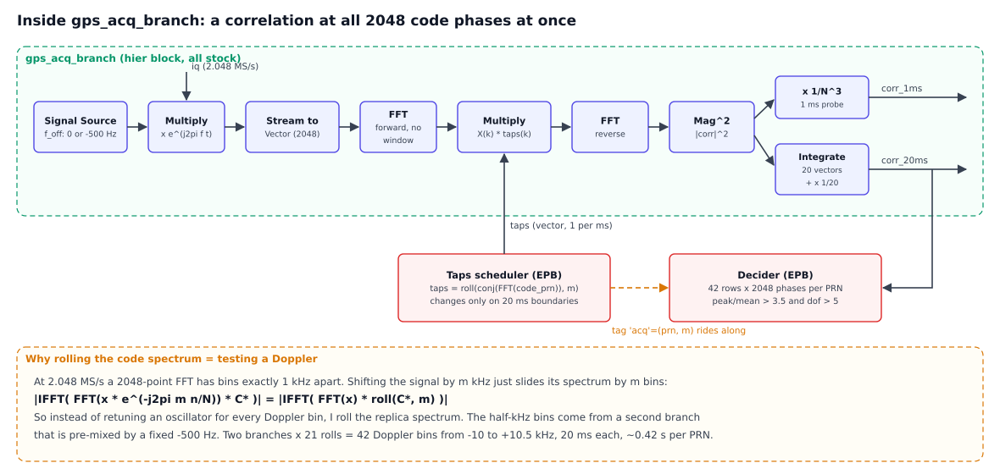

Everything in the green box is stock: Signal Source, Multiply, Stream to Vector, FFT, Multiply (by the taps), FFT (reverse), Complex to Mag², Integrate. Two outputs come out, and both are probes: one single 1 ms correlation, and the sum of 20 of them.

### Why sum 20 milliseconds?

One millisecond is not enough to trust. The 1 ms correlation has noise spikes up to about 10× the average, and a 40 dB-Hz satellite is only a few times the average. So I add 20 consecutive milliseconds **non-coherently** (adding $|C|^2$, not $C$, so the unknown phase and any data-bit flip don't matter). Noise averages towards a flat floor; a real satellite keeps standing up.

You can watch exactly this in the lab. There's a **park mode**: two sliders that pin the search to one PRN and one Doppler bin. Parked on PRN 3 at −1 kHz, the single 1 ms correlation shows a spike of about 30 among noise spikes up to about 10, while the 20 ms sum shows a clean spike of about 26 on a floor of about 1.3. Move the Doppler slider one step and the spike sinks into the floor. That's the frequency tolerance of the previous section, live on your screen.

### Two Python blocks, and why they're there

The **taps scheduler** decides which PRN and which Doppler roll to test in each 20 ms window, and outputs the right taps vector every millisecond. It skips PRNs that are already being tracked. No stock block can produce a vector sequence that follows a schedule and listens to messages, so this one is Python.

The **decider** collects all 42 rows for one PRN, finds the biggest cell, and decides whether it's a satellite. That's a decision across a 2-D grid built up over time: Python again.

The interesting problem was how the decider knows *which* PRN and Doppler each result belongs to. Results arrive after travelling through a chain of blocks with buffers of unknown size. My first instinct was "throw away a result or two after every change". That's slow and fragile. GNU Radio has a much nicer tool: **stream tags**. The scheduler stamps each 20 ms window with a tag `acq = (prn, m)`. GNU Radio carries that tag through Multiply, IFFT, Mag² and Integrate (even through the 20:1 decimation, adjusting the position for it) until it lands on exactly the right result at the decider. No guessing, no throwaway.

### The decision

A PRN counts as found when two tests pass:

1. **peak/mean > 3.5.** With pure white noise, the biggest of those 86,000 cells reaches only about 2.2–2.6, so 3.5 is comfortable. A 45 dB-Hz satellite scores around 21; 39 dB-Hz still scores about 7.
2. **The 20 ms sum really averaged 20 independent milliseconds** (more on why in the war stories). I measure this from the spread of the noise cells: about 20 for white noise, and I reject anything below 5.

Then I refine the Doppler between bins with a parabola through the three cells around the peak, convert the winning code phase into the absolute sample index of a code epoch (I call it `s_ref`), and send an `assign` message to a free tracking channel.

Here's what a whole search looks like for PRN 3, plus the metric for all 32 PRNs (computed on my synthetic test recording):

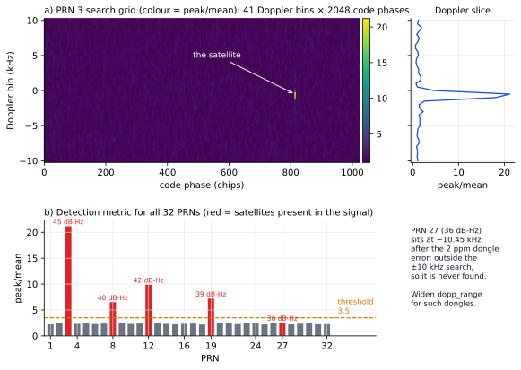

One bright cell in 86,000. That's a satellite.

A full sweep through all 32 PRNs takes about 13 s in the lab (21 steps × 20 ms × 32 PRNs, minus the ones already tracked). The compact `gps_l1_despread` does it in about 5 s, because one Python block tests all 42 Doppler bins in one go. That's the price of being able to see every intermediate signal, and I think it's worth paying in a lab.

---

## Part 4: tracking, the 1 ms loop

### Why tracking is a loop

Acquisition gives a snapshot: code phase and Doppler, right now. But the satellite moves at about 4 km/s, its Doppler drifts, and my dongle's crystal drifts with temperature. Within a second or two the snapshot is stale, the replica slides off the triangle, and the line disappears.

So each tracking channel runs a feedback loop, once per millisecond: correlate, measure the error, nudge the replica, repeat. This is the one part that **has to** stay in Python. GNU Radio stream connections can't carry feedback at sample level (a stream loop either deadlocks or adds many milliseconds of buffer delay), and message ports are asynchronous. A loop whose output steers its own input every millisecond has to live inside one block.

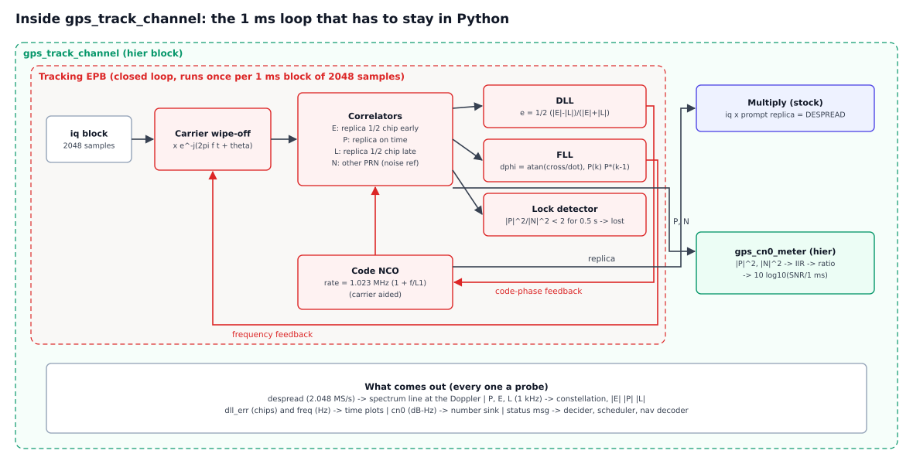

Here's what happens every 1 ms block of 2048 samples:

1. **Carrier wipe-off.** Multiply by $e^{-j(2\pi \hat f t + \theta)}$ to remove the current frequency estimate. This is a *numerically controlled oscillator* (NCO): a phase accumulator advanced by $\hat f$.
2. **Four correlators.** Multiply by four versions of the code and sum over the millisecond:
   - **P** (prompt): the replica where I think the code is;
   - **E** (early): half a chip ahead, which is one sample at 2.048 MS/s;
   - **L** (late): half a chip behind;
   - **N**: a *different* PRN's code at the same timing, which can only ever pick up noise. My noise reference.
3. **DLL (delay-locked loop).** Look at the triangle again. If the replica is perfectly centred, E and L sit symmetrically on both slopes and $|E| = |L|$. If the replica runs late, E climbs and L falls. The discriminator
   $$e = \tfrac12\,\frac{|E|-|L|}{|E|+|L|}$$
   turns that into an error in chips (on the ideal triangle it equals the offset exactly), and the code NCO is nudged by $0.3\,e$ per millisecond. Using magnitudes makes it blind to carrier phase; normalising makes it blind to signal strength.
4. **FLL (frequency-locked loop).** Compare this millisecond's P with the last one. If the phasor has rotated, the frequency is off. The discriminator is $\Delta\varphi = \arctan(\text{cross}/\text{dot})$ of $P_k P_{k-1}^*$, and the frequency estimate moves by $0.05\,\Delta\varphi/(2\pi\cdot 1\,\text{ms})$. Using `atan` (not `atan2`) makes it ignore 180° jumps, so data-bit flips don't upset it. It can pull in errors of up to ±250 Hz, and the noise bandwidth works out to about 13 Hz.
5. **Lock detector.** If $|P|^2/|N|^2$ (smoothed over about 50 ms) stays below 2 after the first half second, which means C/N0 below 30 dB-Hz, the channel says `[LOST]` and frees itself for the next satellite.

### A lovely RTL-SDR coincidence: carrier aiding

The DLL has a surprisingly easy job, for a reason I find really elegant. The code rate the replica needs is

$$r_c = 1.023\,\text{MHz}\cdot\Big(1 + \frac{\hat f}{f_{L1}}\Big)$$

which is called **carrier aiding**: the frequency loop's estimate predicts how fast the code is drifting, so the DLL only has to correct a small leftover.

Now, an RTL-SDR derives *both* its LO and its ADC clock from the same 28.8 MHz crystal. If that crystal is off by $\epsilon$, the carrier I see shifts by $-\epsilon f_{L1}$, and the code rate *in samples* shifts by exactly the same factor. Feed the measured $\hat f$ into the formula above and the crystal error cancels out of the code loop completely. In my tests with a 2 ppm crystal error (3.15 kHz at L1!), every satellite tracked without the DLL even noticing. A cost-saving single-crystal design ends up being a gift to GPS receivers.

### The despread output, and why I keep the carrier

The tracking EPB also outputs its prompt replica as a stream, and a **stock Multiply** forms `input × replica`. Notice that this removes the code but deliberately **not** the carrier. So each locked satellite appears on the spectrum as a line at *its own* Doppler, four satellites as four separate lines, instead of all piling up on 0 Hz (right on top of the DC notch).

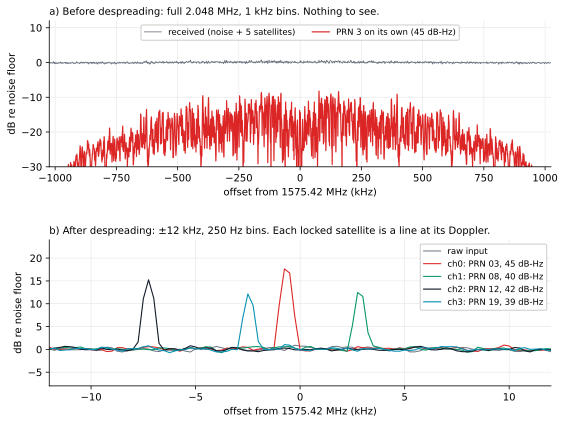

Top: the whole 2 MHz band before despreading, noise and nothing else, even though five satellites are in there (the red trace is where PRN 3 alone would sit, well under the floor). Bottom: the four channel outputs. Four lines, 12–18 dB tall.

You can even predict the height: in 250 Hz bins with a Blackman-Harris window, line height ≈ C/N0 − 27 dB. So 45 dB-Hz gives about 18 dB, and that's what I measured.

### C/N0, the stock way

The **gps_cn0_meter** hier block turns P and N into a live strength readout, using only stock blocks:

$$\text{C/N0} = 10\log_{10}\!\left(\frac{\overline{|P|^2}/\overline{|N|^2} - 1}{1\,\text{ms}}\right)$$

Complex to Mag² on both, a Single Pole IIR on each, a Divide, an Add Const of −1, a floor so the log never sees zero, and a Log10 with +30. On the synthetic recording it read 44.5 / 39.1 / 41.2 / ~38 dB-Hz for satellites that were really 45 / 40 / 42 / 39. Not bad for nine stock blocks.

### What the Tracking tab shows

When I first ran the lab on a real pre-recorded GPS file, the Tracking tab was honestly the most satisfying screen in the whole project:

- **The P constellation:** two tight, opposite clusters per channel. Those are the navigation bits! The pair slowly rotates, because the FLL locks frequency but not phase.
- **Channel 0's P against time:** sharp ± jumps, every flat stretch a multiple of 20 ms long. Only GPS navigation data does that.
- **|E|, |P|, |L|:** |P| on top, |E| ≈ |L| below it.
- **The DLL error:** noise centred on zero on every channel.

One detail surprised me. On my synthetic data, |E| and |L| sat at half of |P|, exactly as the triangle predicts. On the real recording they sat at about **0.65 × |P|**. That's not a bug. The real front end (and the 2.048 MS/s sampling) cuts off part of the C/A spectrum, and band-limiting rounds off the top of the triangle, so the ±½-chip correlators land higher on it. The DLL doesn't care: it only needs |E| = |L|.

---

## Part 5: reading the navigation message

At this point the receiver can see satellites. The last step is to make them *say* something.

### Bit sync: where are the 20 ms edges?

Every data bit lasts 20 ms, but the tracker's P dumps come every 1 ms, and I don't know which millisecond a bit starts on. So I ask a simple question 20 times over: if I sum 20 consecutive P values starting at offset 0, 1, ... 19, which offset gives the most energy? A window that straddles a bit flip partly cancels itself. A window aligned with the bits never does. The aligned offset wins.

In stock blocks: Moving Average (length 20, as a running sum), Complex to Mag², Stream to Vector (20) to put the 20 offsets side by side, a Single Pole IIR on the vector to smooth over about 0.4 s, and **Argmax**. Then a little trick: a stock **Function Probe** reads the argmax twice a second and writes it into a variable, which sets the offset of a stock **Keep 1 in 20**. GNU Radio blocks talking to each other through a GRC variable. Sneaky, but all stock.

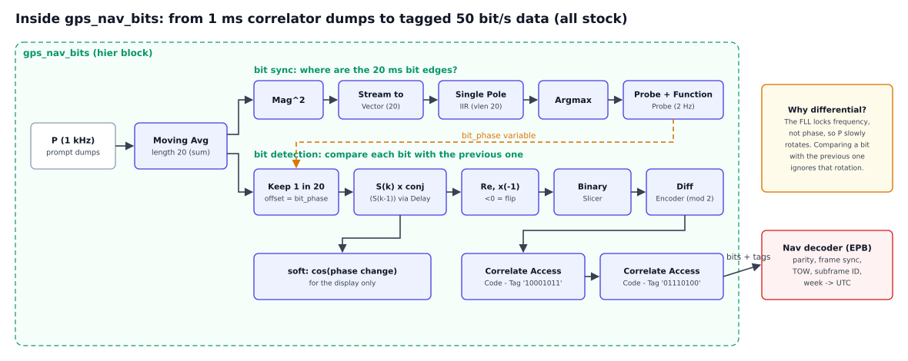

The Navigation tab shows the bit-sync curves: one rounded peak per channel, right at its bit edge (11, 9, 18 and 2 ms on my test file).

### Bit detection: compare, don't judge

Here's a subtlety. Because the FLL locks frequency but not phase, P slowly rotates. I can't just ask "is this bit positive?", because "positive" keeps turning. So I use **differential detection**: compare each 20 ms sum $S_k$ with the previous one,

$$\text{Re}\{S_k\, S_{k-1}^*\}$$

If it's positive, the bit didn't change; if it's negative, it flipped. A slow rotation of a few degrees per bit doesn't matter. Stock blocks again: Delay, Multiply Conjugate, Complex to Real, Multiply Const (−1), Binary Slicer (1 = flip), and a **Differential Encoder** (modulus 2), which is just a running XOR that turns "flipped / didn't flip" back into actual bits.

The result is correct up to one overall inversion, because differential detection can't know whether the very first bit was a 0 or a 1. Hold that thought.

Then two stock **Correlate Access Code – Tag** blocks mark every occurrence of `10001011` (the GPS preamble) and its inverse `01110100`.

### The message itself

The GPS navigation message (the "LNAV" message, in IS-GPS-200) is organised like this:

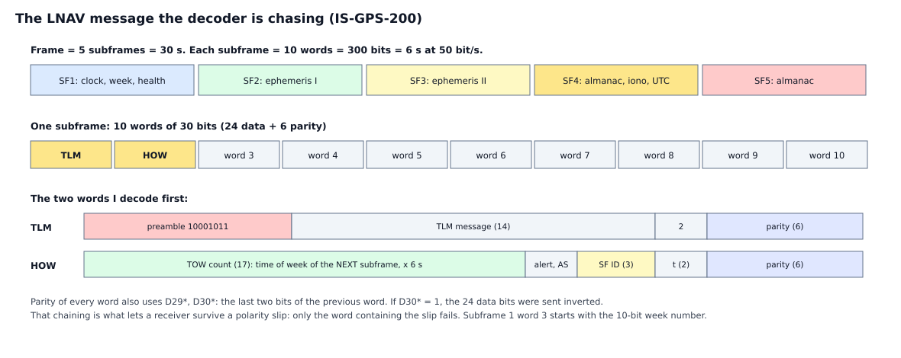

Five subframes of six seconds each make a 30 s frame. Every subframe starts with two special words: **TLM**, which begins with the 8-bit preamble, and **HOW** (hand-over word), which carries the **TOW count**: the GPS time of week, in 6-second units, of the *next* subframe, plus the subframe ID (1 to 5). Subframe 1's third word starts with the 10-bit **week number**.

Each 30-bit word has 6 parity bits. Here's the clever part of the parity scheme: every word's parity also uses **D29\* and D30\***, the last two bits of the *previous* word, and if D30\* is 1, the 24 data bits were sent inverted. Hold that thought too.

### Frame sync: don't trust a preamble

A tagged preamble is only a *candidate*. Eight bits will match `10001011` by pure chance roughly every 256 bits, so the tags in the Navigation tab show several false ones. (I left them visible on purpose. They're a nice reminder that a sync word alone is not proof.)

My decoder EPB accepts a candidate only when TLM and HOW pass parity, **and** the next subframe, 300 bits later, starts with a preamble whose TLM and HOW also pass. After that, every 300 bits it checks each word's parity, reads the TOW and subframe ID from HOW, reads the week number from subframe 1, and converts it all to UTC:

- TOW of this subframe = TOW count × 6 − 6 s,
- full week = 10-bit week + 2048 (two rollovers since April 2019),
- UTC = GPS time − 18 s (the leap seconds since 2017).

Here's the moment it all paid off, on my synthetic 30 s recording (which carries real-format subframes for 9 November 2026, 04:00:00 UTC):

```
[NAV ch3] PRN 19 frame sync: preamble at bit 605, polarity normal, TLM+HOW parity OK on two consecutive subframes
[NAV ch3] PRN 19 subframe 1  TOW 100830 s = Mon 04:00:30 GPS  week 2444 (10-bit 396), URA 2, health OK, IODC 368  -> UTC 2026-11-09 04:00:12
[NAV ch3] PRN 19 subframe 2  TOW 100836 s = Mon 04:00:36 GPS  -> UTC 2026-11-09 04:00:18
```

04:00:12 UTC is exactly 12 seconds into a recording that starts at 04:00:00. All four satellites agreed. I may have cheered a little.

The timing to expect: acquisition, then about a second of bit sync, then up to 6 s waiting for the next preamble, then one more subframe to confirm. So the first decoded line arrives 12–20 s after a satellite locks, and the week number shows up once every 30 s, with subframe 1.

---

## Part 6: war stories (the bugs that taught me something)

Things rarely work the first time. Here are the ones worth telling you about, because each one is a lesson that goes beyond GPS.

### 1. The 17.5-minute crash

My first real-dongle run crashed after exactly 17.5 minutes. The decider sends the trackers a sample index, and after $2^{31}$ samples (17.5 minutes at 2.048 MS/s) that number no longer fits in 32 bits. GNU Radio's `pmt.to_pmt()` turns a Python int into a C `long`, which is **32 bits on Windows** but 64 bits on Linux, where I had tested. Now it travels as a float, which is exact up to $2^{53}$ samples (about 140 years). Lesson: anything that counts samples will eventually overflow somewhere.

### 2. Every satellite found, every satellite lost

The same run "acquired" every PRN from 1 to 32, each at peak/mean 9–15, and every channel reported `[LOST]` half a second later. Real satellites don't do that.

The numbers gave it away. If the 20 ms sum averages 20 independent milliseconds, the noise max is about 2.5. But if something *identical* repeats every millisecond, the sum averages nothing, and the biggest of 86,000 cells reaches about $\ln(86000) \approx 11$, for any PRN. Interference that repeats every 1 ms or every 125 µs (USB 2.0's microframe period) does exactly that. I simulated it at +10 dB and got peak/mean 8–13 on every PRN, a near-perfect match.

Peak/mean alone had a blind spot, so I added the second test: measure how many independent milliseconds the sum really contained. White noise gives about 20; that interference gives about 1. Now it prints `[INTERFERENCE]` instead of lying. Lesson: a detection statistic is only as good as the noise model behind it.

### 3. A status line that crashed the receiver

In the compact version, the status line once tried to print the C/N0 of a channel that had been assigned but hadn't tracked a single millisecond yet. Its averages didn't exist, and the comparison blew up the block's thread. My synthetic tests just never hit that timing. Lesson: "it never happened in testing" is not the same as "it can't happen".

### 4. GRC versions disagree on port order

A hier block's ports are stored in the `.grc` file by *number*, and I learned the hard way that different GRC versions number them differently. My 3.10.9 sorted the pad blocks by name; on my Windows 3.10.10, `gps_nav_bits` came out with two outputs swapped (a float wired into a vector plot, shown as red connections). Swapping them by hand fixed it. I still haven't pinned down the exact rule 3.10.10 uses, so treat hier-block port order with suspicion when moving between versions, and check for red lines.

### 5. The loop bandwidth trade-off (synthetic data lied to me)

This one is my favourite, because I got it wrong in an instructive way. On the synthetic recording, the 13 Hz FLL let the frequency wander about ±7 Hz at 40 dB-Hz, enough to turn the phase about 50° per 20 ms bit and cause occasional bit errors. So I narrowed the loop 5× after lock: zero errors. Great!

Then I ran it on a real recording and the constellation smeared into rings. A narrow loop reacts slowly, and a real dongle's oscillator wanders on its own. At 1575 MHz, one part per *billion* is already 1.6 Hz. My synthetic signal had a perfect oscillator, so it only ever showed the noise side of the trade-off.

I went back to 0.05 (13 Hz) as the default, which looked best on real data. The weakest satellite on the synthetic file now has an occasional bit slip, and the decoder survives it, which brings me to...

### 6. One wrong bit flips everything after it

Differential detection has a nasty property: misread one transition, and *every* following bit comes out inverted. My first decoder fixed the polarity once, at frame sync, so a single slip ruined everything after it.

Remember the D29\*/D30\* chaining from Part 5? It exists precisely for this. Each word is checked against the last two bits *as received* of the previous word, so after a polarity slip only the word containing the slip fails; everything after it decodes fine. The decoder now reads the polarity of every subframe from its own preamble and decodes whichever words pass. The GPS designers thought hard about this decades ago, and it still works.

### 7. The smaller ones

- **Python's GIL:** six Python blocks share one interpreter lock and take turns. Processing 16 ms per tracker call instead of 1 ms made the whole lab about 4× faster.
- **grcc and missing parameters:** add a parameter to an EPB but forget to write it into the `.grc`, and `grcc` generates `fll_narrow=,`. A syntax error. Write every parameter explicitly.
- **A hier port's vector length can only use a hier *parameter*,** not a variable, because GRC sizes the ports before variables exist.
- **QT GUI Vector Sink autoscale** sometimes hid curves when several inputs had very different sizes, even though the data was perfectly finite. The bit-sync plot now shows dB on a fixed axis, which is more readable anyway.

---

## Results

On my synthetic recording (five satellites at 36–45 dB-Hz, a 2 ppm crystal error, a DC spike), in GNU Radio:

- 4 satellites acquired and tracked (PRN 3, 8, 12, 19), frequency within ±5 Hz, C/N0 within 1–2 dB.
- PRN 27 never found, correctly: the 2 ppm error pushed it to −10.45 kHz, outside the ±10 kHz search.
- No false acquisitions, including with interference repeating every 125 µs at +10 dB.
- Navigation data decoded on all four, with the same UTC to the second.
- Real time, with the GUI, on a 2-core machine.

On a real pre-recorded GPS file on my Windows laptop: four channels locked and held, navigation bits clearly visible, DLL centred.

On my live antenna... honestly, so far only one satellite, PRN 08, as a nice 15 dB line on the despread waterfall and nothing on the raw one. My RF environment (and quite possibly USB noise) is the bottleneck, not the receiver. The recording test proves the software end to end. Fixing the antenna side is next on my list.

---

## How to run it

1. Put all five `.grc` files in one folder.
2. In GRC, open and *Generate* the hier blocks **in this order** (the tracking channel contains the C/N0 meter):
   1. **gps_cn0_meter.grc**
   2. **gps_acq_branch.grc**
   3. **gps_track_channel.grc**
   4. **gps_nav_bits.grc**
3. *View → Reload Blocks*. A "GPS Lab" category appears.
4. Open **gps_l1_lab.grc**. If any connection is red, see war story 4.
5. Set the source arguments (`rtl=0,bias=1` for an RTL-SDR Blog V3 bias-tee), the gain (around 40 dB), and the ppm correction if your dongle has no TCXO.
6. Run, and watch the tabs: Spectrum, Acquisition, Tracking, Navigation data.

A few notes:

- **No TCXO?** Your dongle can be tens of ppm off, i.e. tens of kHz at L1. Measure the error, enter it as ppm, and keep the ±10 kHz search. Widening the search works too, but costs CPU and time.
- **Antenna power:** active antennas need 3–5 V on the coax. No power, no LNA, no satellites.
- **Sky:** outdoors gives 40–48 dB-Hz. A window gives a few satellites at best.
- **USB noise:** if you see `[INTERFERENCE]`, try a USB 2.0 extension cable to move the dongle a metre or two away from the laptop, add a ferrite, and avoid USB 3.0 ports.

---

## TODO

There's a lot of room for improvement!

- A **Costas PLL**, assisted by the FLL, to lock carrier *phase*. The constellation would become two fixed dots, and the bits could be read coherently (about 3 dB more robust than differential detection).
- Decode the **ephemeris** (subframes 2 and 3).
- Compute **pseudoranges**, then a **position fix**.
- Pin down the hier-block port-order rule across GRC versions.
- More channels (CPU permitting).
- A proper live-sky test from a better RF location.

---

## Acknowledgements

- The **GNU Radio** project, and **radioconda** for making it painless on Windows.
- **osmocom / gr-osmosdr** and the **rtl-sdr** developers.
- **IS-GPS-200**, the interface spec, for the code generator, signal parameters and message format.
- **K. Borre, D. Akos et al.**, *A Software-Defined GPS and Galileo Receiver*, for the FFT acquisition idea and the tracking-loop structure.
- **E. D. Kaplan and C. J. Hegarty**, *Understanding GPS/GNSS*, for the theory behind it.
- **GNSS-SDR** and **GNSS-SDRLIB**, the serious open-source receivers, to check my numbers against.
- **Claude (Anthropic)**, for helping write and test the code and this document.
