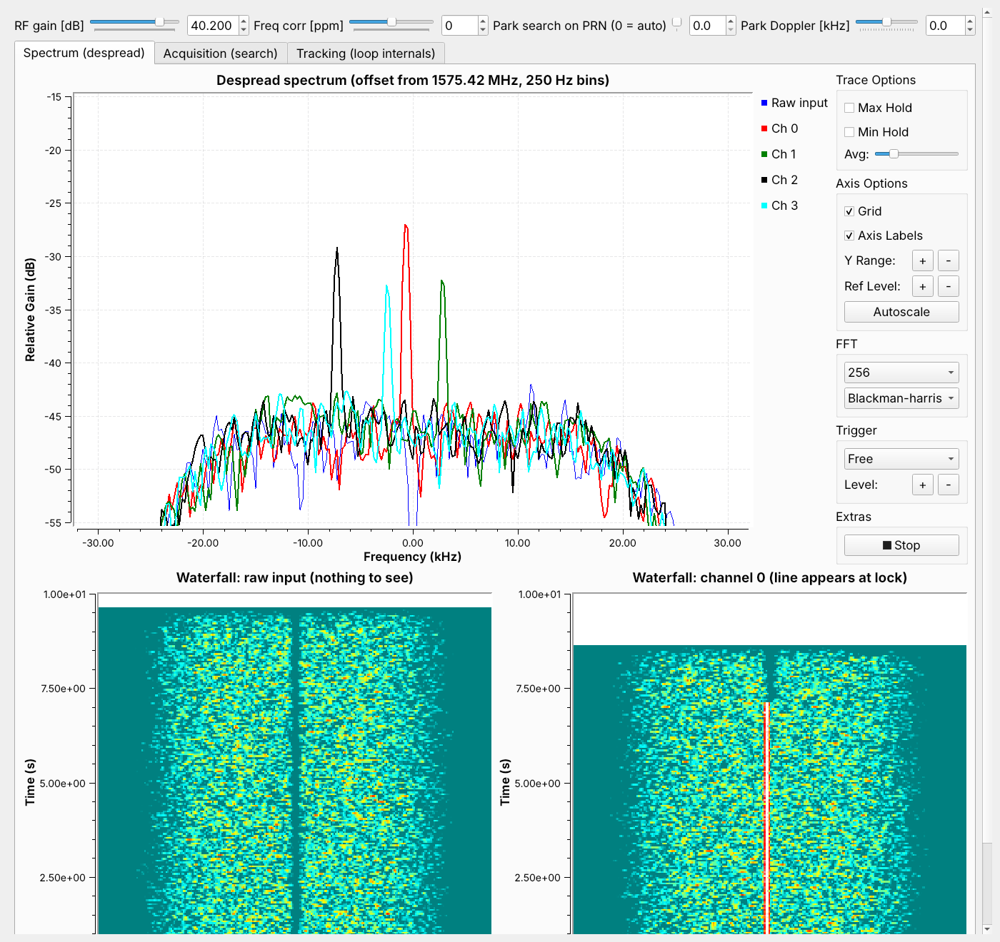
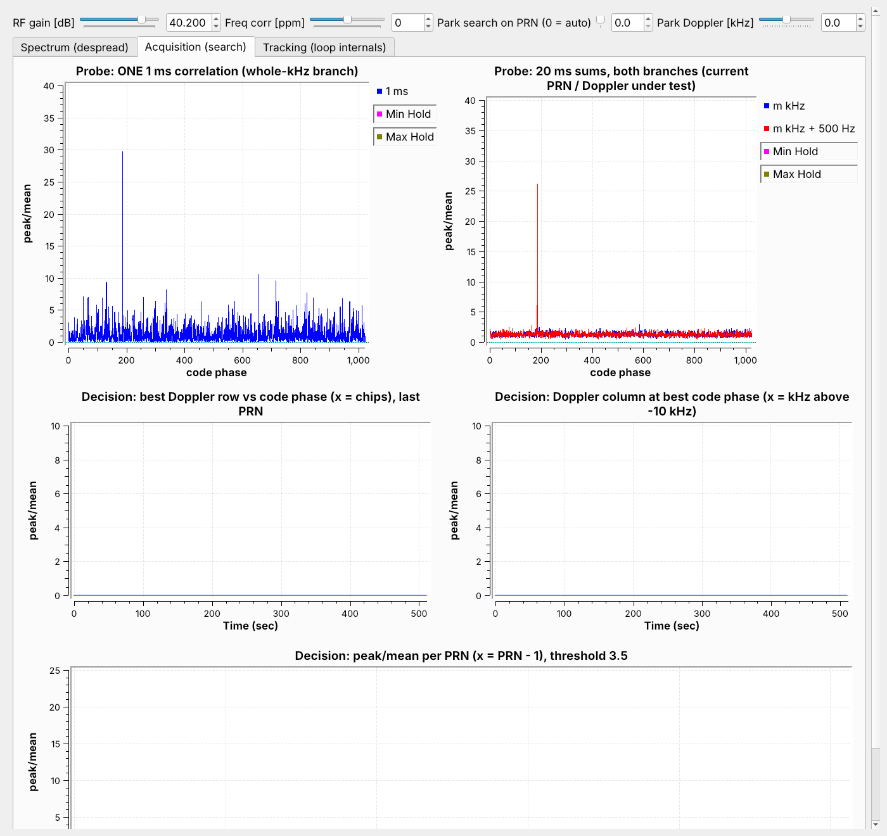
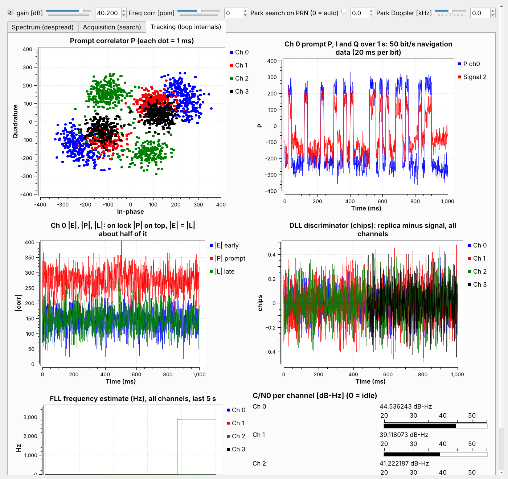

# GPS L1 C/A Lab — every stage of acquisition and tracking, probed

**Files:** `gps_l1_lab.grc` (top level), plus four hier blocks: `gps_acq_branch.grc`, `gps_cn0_meter.grc`, `gps_track_channel.grc`, `gps_nav_bits.grc`. GNU Radio Companion 3.10.
**Relationship to `gps_l1_despread.grc`:** same receiver, opened up. The original stays as the compact, fast version: one EPB that does everything. This lab splits that EPB so every stage outside the tracking loop is stock blocks you can probe.
**Revised 2026-11-09:** added navigation-data decoding — bit sync, frame sync, parity, time of week, week number, UTC — as a new hier block `gps_nav_bits` (stock blocks only), a decoder EPB and a **Navigation data** tab (§3, §4). The tracking channel's frequency loop now narrows after pull-in, so **regenerate `gps_track_channel`** too.
**Revised 2026-11-07 (after the first real-dongle run):** fixed a crash after 17.5 min on Windows, and added an interference test to acquisition (§5, items 5–6). Only `gps_l1_lab.grc` changed; the hier blocks are unchanged.
**Status (2026-11-09):** all four files compile with `grcc` and run in GNU Radio 3.10.9 on the synthetic five-satellite recording, in real time with the GUI on a 2-core machine. **Verified on a real pre-recorded GPS IQ file in GNU Radio 3.10.10 on Windows (radioconda): four satellites acquired and tracked** (§4). Live-antenna runs are still limited by local interference (§5, item 6).

---

## 1. Installing on Windows (radioconda)

The hier blocks must be generated once, **in this order**, because `gps_track_channel` contains `gps_cn0_meter`:

1. Put all four `.grc` files in one folder.
2. In GRC, open **`gps_cn0_meter.grc`** → *Generate* (F5).
3. Open **`gps_acq_branch.grc`** → *Generate*.
4. Open **`gps_track_channel.grc`** → *Generate*.
5. Open **`gps_nav_bits.grc`** → *Generate*.
6. *View → Reload Blocks* (or restart GRC). A **GPS Lab** category appears in the block tree.
7. Open **`gps_l1_lab.grc`** → *Run*.

Generating a hier block writes a `.py` and a `.block.yml` to `C:\Users\<you>\.grc_gnuradio\`. The tracking channel's EPB is written next to them as `gps_track_channel_trk.py`. If you edit a hier block, regenerate it and reload blocks, otherwise the top level keeps using the old copy.

---

## 2. What's stock, what's hier, what's EPB

| Stage | Built from | Why |
|---|---|---|
| RTL source, DC blocker, AGC | Stock | — |
| **Acquisition correlation** (pre-mix, 1 ms vectors, FFT, × replica spectrum, IFFT, \|·\|², 20 ms integrate) | Stock, packaged as hier **`gps_acq_branch`** ×2 | Every intermediate signal can be probed |
| Which PRN / Doppler to test in each 20 ms window | **EPB** `sched` (taps scheduler) | No stock block produces a scheduled vector sequence that reacts to which PRNs are being tracked |
| Peak-picking over the grid, threshold, channel assignment | **EPB** `decider` | 2-D decision across time, then a timing handover to another block |
| **Tracking loop:** code/carrier NCOs, E/P/L/N correlators, DLL, FLL, lock decision | **EPB** inside hier **`gps_track_channel`** ×4 | A 1 ms closed loop (the correlators steer the replica that feeds them). GNU Radio stream connections can't carry sample-level feedback |
| Despreading (input × replica) | Stock Multiply inside `gps_track_channel` | The replica is an EPB output, so the multiplication itself is stock |
| C/N0 | Stock, hier **`gps_cn0_meter`** (nested in `gps_track_channel`) | \|P\|² and \|N\|² → IIR → divide → −1 → floor → 10·log10 + 30 |
| **Bit sync** (20 ms running sum, energy at each of the 20 possible bit alignments, argmax) | Stock, hier **`gps_nav_bits`** ×4 | A Function Probe reads the argmax and sets the offset of a stock Keep 1 in 20 |
| **Bit detection** (20 ms sums, S(k)·conj(S(k−1)), slicer, differential encoder) and **preamble tagging** | Stock, inside `gps_nav_bits` | Differential detection: immune to the FLL's slow phase rotation. Correlate Access Code – Tag marks 10001011 and its inverse |
| Frame sync, parity, TOW / subframe ID / week number → UTC | **EPB** `navdec` | IS-GPS-200 parity chaining and field decoding have no stock equivalent |
| Displays | Stock QT sinks, four tabs | — |

### Two design points worth knowing

**Doppler search with no oscillator retuning.** At 2.048 MS/s a 2048-point FFT has exactly 1 kHz bins, so shifting the signal by *m* kHz is the same as rotating its spectrum by *m* bins. The scheduler therefore tests *m* kHz by rotating the code's spectrum (`np.roll(conj(FFT(code)), m)`), and the stock Multiply does the Doppler search together with the correlation. Half-kHz bins come from the second `gps_acq_branch`, which is pre-mixed by −500 Hz. Two branches give 42 Doppler bins (−10 to +10.5 kHz) in 21 steps of 20 ms, about 0.42 s per PRN.

**A handover that doesn't guess.** The scheduler stamps each 20 ms window with a stream tag `acq = (prn, m)`. GNU Radio carries that tag through Multiply, IFFT, Mag² and Integrate to the decider, so every result is labelled exactly, whatever the buffer latency. The decider turns the winning window index and code phase into an absolute sample index of a code epoch (`s_ref`). A tracking channel can therefore start in phase whenever the assignment message reaches it.

---

## 3. What you can watch



**Tab 1 — Spectrum (despread).** Same as the original: the raw input plus four channel outputs (input × replica), 250 Hz bins. Each locked channel shows a line at its Doppler, about C/N0 − 27 dB tall. The raw waterfall never shows anything; channel 0's waterfall shows a line from the moment it locks.



**Tab 2 — Acquisition (search).**

| Plot | Shows | What to look for |
|---|---|---|
| Probe: one 1 ms correlation | `gps_acq_branch` output `corr_1ms`, whole-kHz branch | Noise spikes up to about 10× the mean. A satellite is only a few times bigger: one millisecond isn't enough to trust |
| Probe: 20 ms sums, both branches | `corr_20ms` of both branches | The floor flattens to about 1–1.5 and a real satellite stands up as a single spike |
| Decision: best row vs code phase / Doppler column / per-PRN bars | Decider messages, one update per completed PRN sweep | Same as the original block |

**Park mode (sliders at the top).** In auto mode the search moves on every 20 ms, so a satellite flashes in the probe plots for one frame only. Set **Park search on PRN** to a PRN (1–32) and **Park Doppler** to a whole kHz, and the search holds that hypothesis, so the probes show it continuously. The screenshot shows PRN 3 parked at −1 kHz (the second branch tests −0.5 kHz):
- **1 ms probe:** a spike of about 30 at code phase ~185 chips, among noise spikes up to about 10.
- **20 ms probe:** a clean spike of about 26 on a floor of about 1.3.

Move the Doppler slider one step away and the spike drops into the noise. That shows the ±500 Hz frequency tolerance directly. Set PRN back to 0 to resume the automatic sweep. No acquisitions happen while parked; channels that are already tracking keep tracking.



**Tab 3 — Tracking (loop internals).**

| Plot | Shows | What to look for |
|---|---|---|
| Prompt correlator P, all channels | One dot per 1 ms | Two opposite clusters per channel: the 50 bit/s navigation bits. The pair slowly rotates, because the FLL locks frequency, not phase |
| Ch 0 P, I and Q over 1 s | Same, against time | ±1 jumps every 20 ms or more: the navigation data you'd decode next |
| Ch 0 \|E\|, \|P\|, \|L\| | Early / prompt / late magnitudes | \|P\| on top; \|E\| ≈ \|L\| at about half of it (the triangle sampled at ±½ chip) |
| DLL discriminator | Code-tracking error, chips | Noise centred on 0. A channel's trace starts at the moment it locks |
| FLL frequency | Each channel's frequency estimate, last 5 s | Steps to the satellite's Doppler at lock, then flat |
| C/N0 meters | Stock `gps_cn0_meter` per channel | 44.5 / 39.1 / 41.2 / ~38 dB-Hz in the test (true 45 / 40 / 42 / 39) |

**Tab 4 — Navigation data.**

| Plot | Shows | What to look for |
|---|---|---|
| Last decoded | The decoder's latest line | e.g. `PRN 19 subframe 2  TOW 100836 s = Mon 04:00:36 GPS -> UTC 2026-11-09 04:00:18` |
| Bit sync | Energy (dB) of a 20 ms sum of P against its start offset, per channel | One rounded peak per channel at the offset where the bit edges are. The argmax becomes the Keep 1 in 20 offset |
| cos(phase change between bits) | Re{S(k)·S*(k−1)} / (\|S(k)\|·\|S(k−1)\|), last 6 s | Values pinned at +1 (same bit) and −1 (bit flip). Values drifting towards 0 mean the frequency loop is letting the phase wander |
| Ch 0 decoded bits | 12 s of bits with tags | Tags mark every preamble candidate. Several are false: 10001011 appears by chance about every 256 bits. The decoder only accepts a candidate whose TLM and HOW words pass parity in two consecutive subframes |

Console lines:

```
[NAV ch3] PRN 19 frame sync: preamble at bit 605, polarity normal, TLM+HOW parity OK on two consecutive subframes
[NAV ch3] PRN 19 subframe 1  TOW 100830 s = Mon 04:00:30 GPS  week 2444 (10-bit 396), URA 2, health OK, IODC 368  -> UTC 2026-11-09 04:00:12
[NAV ch3] PRN 19 subframe 2  TOW 100836 s = Mon 04:00:36 GPS  -> UTC 2026-11-09 04:00:18
```

Time to first decoded line: acquisition, then about 1 s of bit sync, then up to 6 s to the next preamble, then one more subframe (6 s) to confirm frame sync. So 12–20 s after a satellite locks. The week number arrives with subframe 1, once every 30 s.

---

## 4. Test results (synthetic recording, GNU Radio 3.10.9)

Five satellites (PRN 3, 12, 8, 19, 27 at 45, 42, 40, 39, 36 dB-Hz) plus a 2 ppm dongle error, as used for the original receiver.

| | Original `gps_l1_despread` | This lab |
|---|---|---|
| Satellites acquired | 3, 8, 12, 19 | 3, 8, 12, 19 |
| False acquisitions | none | none (after the fixes in §5) |
| Tracked frequency | within ±5 Hz | within ±5 Hz |
| C/N0 (est. vs true) | within 1–2 dB | within 1–2 dB |
| Full 32-PRN sweep | ~4.8 s | ~13.4 s (21 steps × 20 ms × 32 PRN; tracked PRNs are skipped) |
| PRN 27 (pushed to −10.45 kHz by the 2 ppm error) | not found | not found: outside the search, as expected |
| CPU (2-core test VM) | lower | real time with the GUI; 12 s of signal in 8.4 s without the GUI |

### Real recording (2026-11-09, Windows, GNU Radio 3.10.10)

Four channels locked and held. The Tracking tab shows what a real satellite looks like, as opposed to the synthetic one:

- **Navigation bits:** clean ± jumps on 20 ms boundaries in ch 0's I/Q plot, and tight opposite pairs for all four channels in the P constellation. Nothing but a GPS satellite produces that pattern.
- **Ch 0 strength:** |P| ≈ 300 against a 1 ms noise σ of √2048 ≈ 45, i.e. about 46 dB-Hz.
- **|E| ≈ |L| ≈ 0.65·|P|, not 0.5 as in the synthetic test.** The synthetic signal had unlimited bandwidth, so its correlation peak was a sharp triangle. A real front end (and the 2.048 MS/s sampling) cuts off part of the C/A main lobe, which rounds the top of the triangle, so the ±½-chip correlators sit higher on it. This is expected and harmless: the DLL only needs |E| = |L|.

### Navigation data (2026-11-09, synthetic 30 s recording with valid nav messages)

The recording carries real IS-GPS-200 subframes (preamble, parity, HOW with TOW and subframe ID, week number 2444 in subframe 1) for 2026-11-09 04:00:00 UTC, on PRN 3, 8, 12, 19 (45 / 40 / 42 / 39 dB-Hz) with a 2 ppm dongle error.

| | PRN 3 | PRN 8 | PRN 12 | PRN 19 |
|---|---|---|---|---|
| Frame sync | yes | yes (inverted) | yes (inverted) | yes |
| Decoded UTC of subframe 1 | 04:00:12 | 04:00:12 | 04:00:12 | 04:00:12 |
| Bit-transition errors, last 14 s | 0 | 0 | 0 | 0 |

04:00:12 UTC is exactly 12 s into a recording that starts at 04:00:00 UTC, and all four satellites agree.

---

## 5. Things learned building it (useful for your other hier blocks)

1. **GRC orders a hier block's ports by the pad blocks' *names*, alphabetically**, not by their labels or positions. The pads here are named `in0_…`, `out0_…` and so on to make the order explicit. An earlier version silently swapped P and N in the C/N0 meter.
2. **A pad's vector length can only use hier *parameters*, not variables.** GRC sizes the ports before variables exist. That's why `N` (2048) is a parameter of `gps_acq_branch`.
3. **Python blocks share one interpreter lock**, so six Python blocks run one at a time. Processing 16 ms per tracker call (`set_output_multiple(16*N)`) instead of 1 ms cut the run time about 4×.
4. **Normalise each Doppler row on its own.** Rows are measured at different times. While the AGC settled, early rows were weaker, which inflated the global peak/mean and produced one false acquisition. Each row is now divided by its own mean, and the first 500 ms are tagged PRN 0 and ignored.

5. **Windows `long` is 32-bit.** `pmt.to_pmt()` turns a Python int into a C `long`. The sample index sent to the trackers passes 2³¹ after 17.5 minutes, which crashed the decider on Windows. It worked on Linux, where `long` is 64-bit. It's now sent as a float (exact to 2⁵³ samples, about 140 years).
6. **Peak/mean alone is fooled by periodic interference.** The first real-dongle run acquired every PRN with peak/mean 9–15, and every channel lost lock 0.5 s later. That's the signature of interference that is identical in every millisecond: USB or digital noise repeating every 1 ms or 125 µs, or a strong CW spur. The 20 ms sum then averages nothing, so the highest of the 86,000 cells reaches about ln(86000) ≈ 11 for any PRN. The decider now also measures how many independent milliseconds the sum really contained: about 20 for white noise, about 1 for this interference. It rejects candidates below 5 and prints `[INTERFERENCE]`. Test results: the clean recording still acquires all four satellites (19–20 independent ms each). The recording with interference repeating every 125 µs at +10 dB gives zero false acquisitions, where before it gave one per PRN.

7. **Differential detection turns one bit error into a polarity flip.** Every later bit is inverted. The GPS parity scheme was designed for exactly this: each word is checked against the last two *received* bits of the previous word, so only the word containing the flip fails. The decoder therefore reads the polarity of every subframe from its own preamble and decodes whichever words pass, instead of fixing the polarity once at frame sync.
8. **The frequency loop's bandwidth decides the bit error rate.** With the 13 Hz FLL used for acquisition, the frequency wandered about ±7 Hz at 40 dB-Hz, enough to rotate the phase about 50° rms per 20 ms bit. Several bit flips in 14 s on PRN 8, 12 and 19 made two of them fail frame sync. The tracker now uses the wide loop for the first 300 ms, then narrows it 5× (gain 0.01, about 2.5 Hz): zero errors.
9. **`grcc` leaves new EPB parameters empty if the `.grc` doesn't list them**, producing `fll_narrow=,` in the generated code. Every EPB parameter must be written into the `.grc` explicitly.
10. **QT GUI Vector Sink autoscale misbehaves with several inputs of very different size.** One curve, sometimes all of them, disappeared, although the data was finite. The bit-sync plot now shows dB on a fixed axis (55–80 dB), which also makes strong and weak channels comparable.

---

## 6. Limitations

- Works on a real recording. Live-antenna runs at the author's site were disrupted by periodic interference (§5, item 6); that's an RF-environment problem, not a receiver problem.
- The automatic sweep is about 3× slower than the original block. For a TCXO dongle, set `m_max` to 6 to cut it to about 8.3 s.
- Navigation decoding covers TLM/HOW (time of week, subframe ID) and subframe 1 word 3 (week number, health, URA, IODC). Ephemeris (subframes 2–3), pseudoranges and a position fix are not implemented.
- Leap seconds are fixed at 18 s (GPS − UTC since 2017). The UTC shown would be off by one second if a new leap second were introduced.
- The tracker's 1 ms dumps are aligned to the sample stream, not to the code epochs, so the millisecond containing a bit edge mixes two bits. That costs well under 0.5 dB on a 20 ms bit and is visible as the rounded tops of the bit-sync curves.
